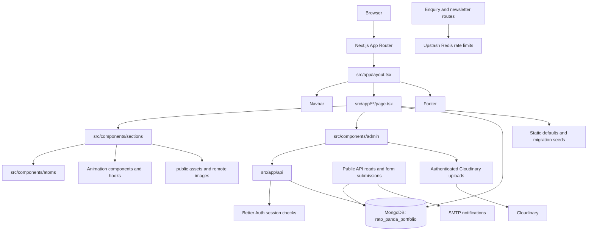

# Current Architecture

This document describes the current repository architecture and runtime data flow. For contribution and delivery conventions, see [rules.md](rules.md).

## System at a glance



MongoDB is the runtime source of truth for Works, Services, Events, Gallery, Testimonials, Stats, Enquiries, Newsletter subscribers, and admin notifications. Static modules remain as migration/default data where applicable. Admin writes use authenticated API routes; public content reads are available to the public.

## Routes

| Route | Entry | Composition or data |
| --- | --- | --- |
| `/` | `src/app/page.tsx` | Public homepage; Client Proof reads Stats and Testimonials from MongoDB |
| `/about` | `src/app/about/page.tsx` | About hero, trust, statement, company specs, team, FAQ, CTA |
| `/services` | `src/app/services/page.tsx` | Service hero, service list, process, CTA |
| `/works` | `src/app/works/page.tsx` | Work hero and all work items |
| `/works/[slug]` | `src/app/works/[slug]/page.tsx` | Work detail and indexed neighbor queries with `notFound()` fallback |
| `/events` | `src/app/events/page.tsx` | Event hero and event listing |
| `/events/[slug]` | `src/app/events/[slug]/page.tsx` | Event detail and indexed neighbor queries with `notFound()` fallback |
| `/gallery` | `src/app/gallery/page.tsx` | Gallery hero, bento gallery, CTA |
| `/contact` | `src/app/contact/page.tsx` | Contact hero and contact form section |
| `/privacy-policy` and `/terms-and-conditions` | matching `page.tsx` files | Static legal pages |
| `/admin` | `src/app/admin/page.tsx` | Redirects to `/admin/dashboard` |
| `/admin/dashboard` | `src/app/admin/dashboard/page.tsx` | MongoDB-backed content counts and recent enquiry activity |
| `/admin/services`, `/admin/works`, `/admin/events`, `/admin/gallery`, `/admin/enquiries`, `/admin/testimonials` | matching `src/app/admin/**/page.tsx` files | Admin lists and content workflows backed by MongoDB APIs |
| `/admin/{services,works,events,gallery,testimonials}/{new,[id]}` | matching admin route files | Authenticated create/edit workflows; service, work, event, gallery, and testimonial media use Cloudinary uploads where applicable |

`src/app/layout.tsx` owns the global fonts, metadata, theme attribute, navbar, footer, and page shell. `src/app/not-found.tsx` is the custom not-found page.

The admin routes share `src/app/admin/layout.tsx`, which checks the Better Auth session. `PublicSiteChrome` suppresses the public navbar and footer on `/admin` routes so the admin shell has its own navigation and header. Write APIs also check authentication independently of the layout.

Blog section components exist under `src/components/sections/blog`, but there is no `src/app/blog` route in the current app. Do not present `/blog` as an available page until routes and content are implemented and reviewed.

## Code organization

- `src/components/atoms`: reusable primitives such as `Button`, `Container`, `Heading`, `Input`, `Logo`, `NavLink`, and `Section`.
- `src/components/navigation`: global `Navbar` and `Footer`.
- `src/components/admin`: admin-only navigation, headers, tables, forms, and confirmation UI shared by admin routes.
- `src/components/sections`: page-level presentation grouped by domain: home, about, services, works, events, gallery, contact, FAQ, and blog.
- `src/features/<domain>`: optional home for domain behavior shared across routes or complex enough to need a feature boundary; avoid adding wrappers for one-off UI.
- `src/components/Animation`: reusable visual effects and animation wrappers using Framer Motion, GSAP, OGL, and shader components.
- `src/components/hooks`: reusable hooks, currently including sticky-stack and scroll-trigger behavior.
- `src/data/works.ts`: typed Works defaults/seed data; public and admin runtime records come from MongoDB.
- `src/data/events.ts`: event domain type and placeholder/seed data; public and admin runtime records come from MongoDB.
- `src/data/content.ts`: separate sample work/article model; this currently overlaps with the primary data model and needs an ownership decision.
- `src/components/sections/services/Service.ts` and `ServicePhase.ts`: service defaults/seed and process data stored beside their presentation components; service records are read from MongoDB at runtime.
- `src/lib/utils.ts`: shared utility functions, including `cn`.

## Admin panel structure

```text
src/
  app/admin/                 Routes and shared admin layout
    layout.tsx               Admin sidebar, header, and content frame
    page.tsx                 /admin overview
    dashboard/page.tsx       /admin/dashboard
    services/**              Services list/create/edit
    works/**                 Works list/create/edit
    events/**                Events list/create/edit
    gallery/**               Gallery list/create/edit
    enquiries/**             Enquiry list/detail
    testimonials/**          Testimonials CRUD and Stats editing
  components/admin/          Reusable admin interface, grouped by domain
  app/api/                   Public reads/submissions and authenticated mutations
  lib/                       MongoDB, auth, validation, notifications, rate limits
```

This follows the App Router boundary: route files select and compose page content, while reusable admin UI lives outside `app` so it is not coupled to a URL. Public sections live under `src/components/sections/<domain>`, reusable primitives under `src/components/atoms`, and admin-only UI under `src/components/admin`. API routes own request validation, session enforcement for writes, and persistence.

`/admin` redirects to the canonical `/admin/dashboard` overview route.

## Client boundaries and state

The root layout and most route files are server components. Interactive sections and admin controls use client components for local state, event handlers, browser APIs, animation, and forms. There is no global client state store; state is local to the component that owns the interaction. Admin notifications are persisted in MongoDB, fetched by an authenticated route, and polled by the header every 40 seconds. Read status is tracked per authenticated user.

## Current risks and technical debt

- Current check status should be refreshed after changes; the most recent validation reported `npm run lint` and `npx tsc --noEmit --incremental false --pretty false` passing. This does not confirm production deployment, visual review, or end-to-end integrations.
- Public enquiry and newsletter routes persist submissions and send email. They use application-level Upstash Redis limits of 5 enquiry requests and 3 newsletter requests per IP per 10 minutes. Production requires `UPSTASH_REDIS_REST_URL` and `UPSTASH_REDIS_REST_TOKEN`; Vercel Firewall rules are configured separately in the Vercel dashboard.
- Some displayed portfolio, event, and service content is still sample or placeholder content and needs owner review for accuracy and rights to use.
- Event records marked `upcoming` include March and April 2026 dates, which are in the past as of 2026-09-29. Confirm event dates and statuses before public launch.
- UX audit dated 2026-09-29: nested `<main>` landmark on `/events`; contact name label is not associated with its input; founder selectors and some team/social profile data need review. Dialog keyboard/focus behavior, gallery controls, and mobile-menu Escape handling were addressed and locally checked on 2026-09-29. Cross-browser and assistive-technology review remains pending. See [testing.md](testing.md) for findings and test status.
- Privacy and terms copy contains operational and data-handling statements that need owner/legal review for accuracy before launch. This is a content review flag, not legal advice.
- The earlier frontend edits listed in `decision.md` remain unapproved and awaiting review. The separately documented dialog, gallery, and mobile-menu changes were approved on 2026-09-29; do not conflate their review status.
- Several components use raw `` elements instead of `next/image`; remote image domains and asset ownership should be standardized.
- `src/data/content.ts` remains sample data and should not become a second source of truth without an explicit decision.
- Some animation components and hooks appear unused and should be confirmed before removal.
- Some dependencies may be unused, including `class-variance-authority` and `lenis`; confirm with repository-wide usage checks before removing anything.
- The current not-found page and route fallback behavior need visual and interaction review on desktop and mobile.

## Frontend review gate

The public frontend is the first delivery phase. Before moving an agreed feature into admin workflow and backend integration, review and approve the user-facing behavior and content described below. This is a staged delivery gate, not a claim that the current repository has no backend integrations.

1. **Routes and content:** Every agreed route exists, navigation and footer links resolve, detail routes handle unknown slugs, and all sample text, project details, images, legal copy, and contact information are approved or replaced.
2. **Responsive layout:** Each route has been checked at agreed mobile, tablet, and desktop sizes. No unintended horizontal overflow, clipped text, overlapping controls, broken media, or layout shifts remain.
3. **Interactions and states:** Menus, links, accordions, filters, animations, and forms behave as designed. Forms have reviewed idle, validation, pending, success, and failure states. Submission feedback must accurately reflect whether a real endpoint and delivery service are configured.
4. **Accessibility and motion:** Keyboard navigation, visible focus, semantic headings and labels, useful image alternatives, contrast, reduced-motion behavior, and screen-reader status messages have been checked.
5. **Quality checks:** `npm run lint`, `npx tsc --noEmit`, and `npm run build` pass. Critical route and interaction smoke checks pass on the production build.
6. **Owner sign-off:** The owner has reviewed the deployed or preview experience and explicitly accepted the content, responsive behavior, visual details, and remaining known limitations.

Record the review date, viewport/browser coverage, known exceptions, and owner approval before declaring the frontend phase complete. A passing build alone is not frontend sign-off.

## Data persistence and migrations

- `scripts/migrate-data.ts` upserts bundled defaults without overwriting existing documents and also creates the collection indexes/counters required by the current write flows. Run it explicitly against the intended database after index/counter changes.
- Work mutations are serialized through a MongoDB transaction helper because display IDs are renumbered after create/delete/import. This requires MongoDB transaction support.
- Events, Services, Gallery, and Testimonials use atomic counters for new IDs. Unique indexes enforce their configured natural keys/IDs.
- Gallery and notification feed indexes are initialized through the same migration. Notifications are written for enquiries, newsletter subscriptions, content create/edit/delete actions, and Stats edits.
- Admin images and gallery videos are uploaded via the authenticated Cloudinary endpoint; MongoDB stores their URLs.

## Delivery sequence

The agreed development order is **public frontend first, admin panel second, backend integration third**. Treat these as clear phases while allowing an owner-approved feature to cross phases when necessary. Backend work should preserve the approved UI unless a visual change is explicitly requested. For the one-finding-at-a-time review workflow and folder conventions, follow [rules.md](rules.md).

Use [testing.md](testing.md) as the launch test plan and record. A passing build does not replace route/content approval, viewport and interaction checks, accessibility review, a deployed-preview smoke test, or owner sign-off.
